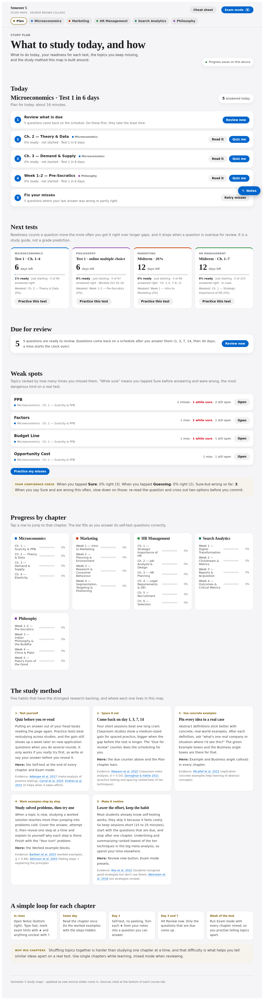
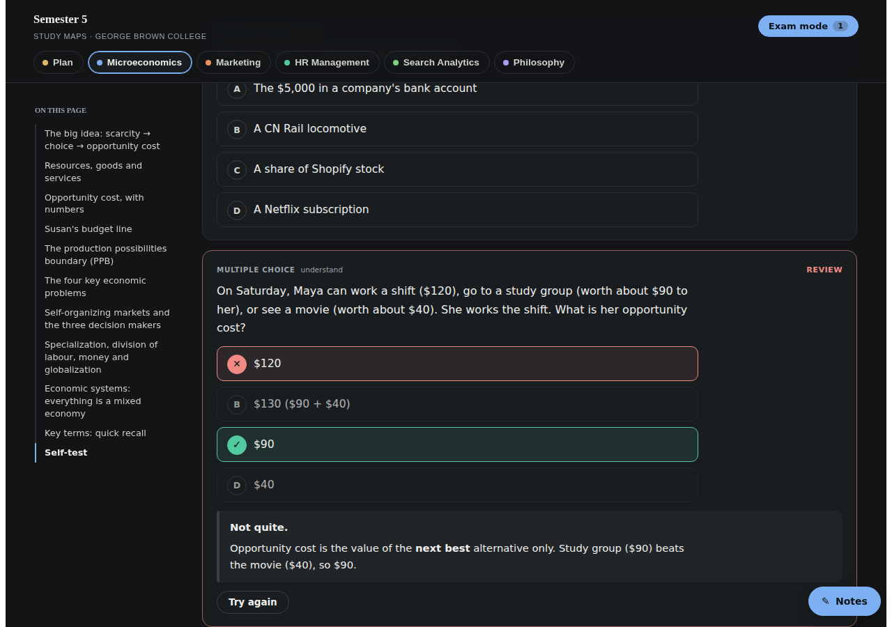
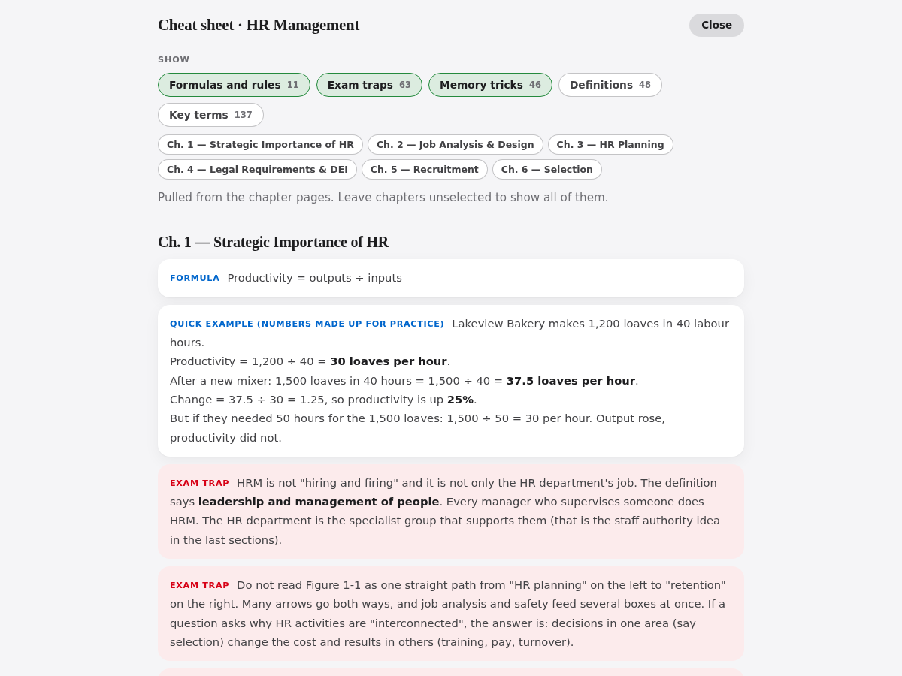
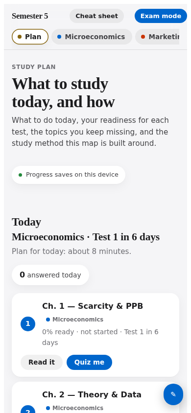

# Study Maps

A single-page study app I built with Claude for my Semester 5 courses at George Brown College (Honours BBA, Business Analytics). It started as chapter summaries and grew into a small study system: self-tests, spaced review, exam mode, a weak-spot report and a plan tab with deadlines.



## Why I built it

- **To save time.** Every course has its own slides and its own textbook. I wanted all of them in one place instead of jumping between files before every test.
- **To make ideas stick.** After each part of a chapter I wanted real-life and work examples, so the material is useful beyond the exam.
- **To keep my plans in the same place.** The plan tab tracks deadlines, test dates, readiness and weak spots, so I always know what to study today and what is the best use of my time.

## What it does

- **22 chapter panels** across 5 courses (Microeconomics, Marketing, HR Management, Search Analytics, Philosophy). Each has learning goals, definitions, examples, exam traps, worked examples with hidden steps, flashcards and SVG diagrams.
- **373 self-test questions** plus an Exam mode. Multiple choice is auto-graded. Short and apply questions are self-graded against a model answer.
- **Spaced review.** Answers come back on a schedule (0, 1, 3, 7, 14 and 30 days). Tapping "Sure" or "Guessing" before each answer flags the dangerous case: sure but wrong.
- **Plan tab.** What to do today, deadlines and exams, readiness per test, due for review, weak spots and progress by chapter.
- **Cheat sheet** for each chapter, built from the panel content.
- **Notes drawer**, light and dark themes, and a layout that works at phone width.

| Dark mode quiz | Cheat sheet | Phone |
|---|---|---|
|  |  |  |

## How it is built

- **Plain HTML, CSS and JavaScript.** No framework. Progress is saved in the browser (localStorage).
- **A Python build script** (`build/build.py`) stitches the page shell and the chapter fragments into one self-contained HTML file.
- **SVG diagrams** are generated and dropped into the panels at build time.
- **Playwright scripts** in `tools/` check the finished page (downloads, jump buttons, all panels).
- Design notes are in [docs/02-design-system.md](docs/02-design-system.md). The logic behind each feature is in [docs/03-features-and-how-they-work.md](docs/03-features-and-how-they-work.md).

## Limits and next steps

- Progress is saved in each browser, so it does not sync between phone and laptop yet. An export/import button is next.
- The chapter content is private, so this public copy does not build on its own.
- Next: a day-by-day study plan based on test dates and readiness, and more real-life and work examples after each section.

## What is in this repo

```
build/shell/   the app: app.js, CSS, plan tab and overlays
build/         build script and authoring helpers
tools/         page checks and the index builder
docs/          design system, feature notes and screenshots
```

The chapter content comes from my lecture slides and a course textbook, so it is not in this public repo. That means this copy shows the app and how it works, but it does not build on its own.
