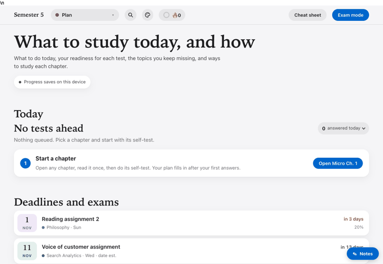
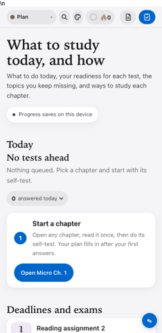
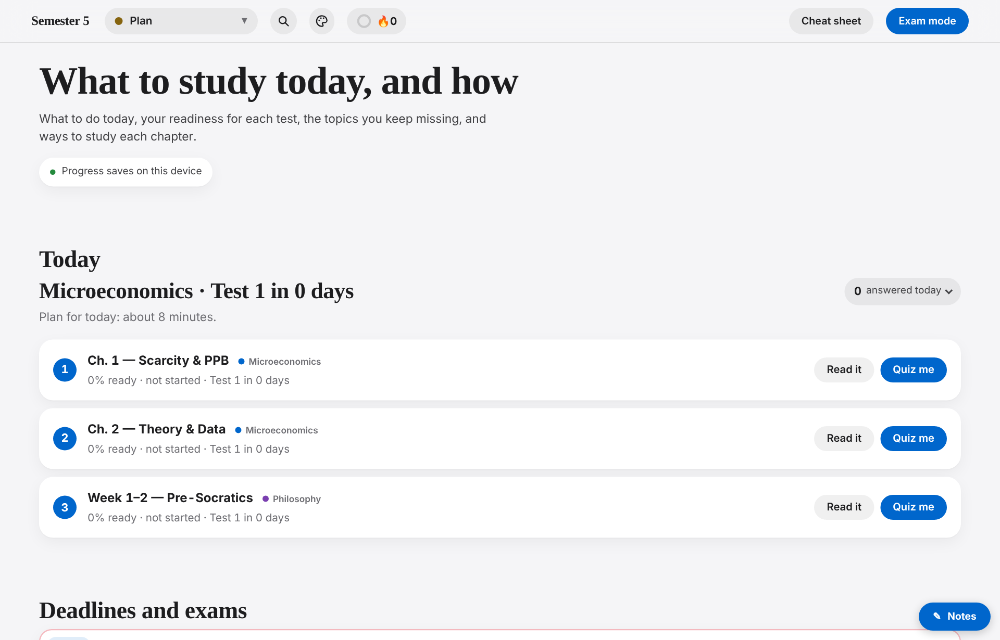
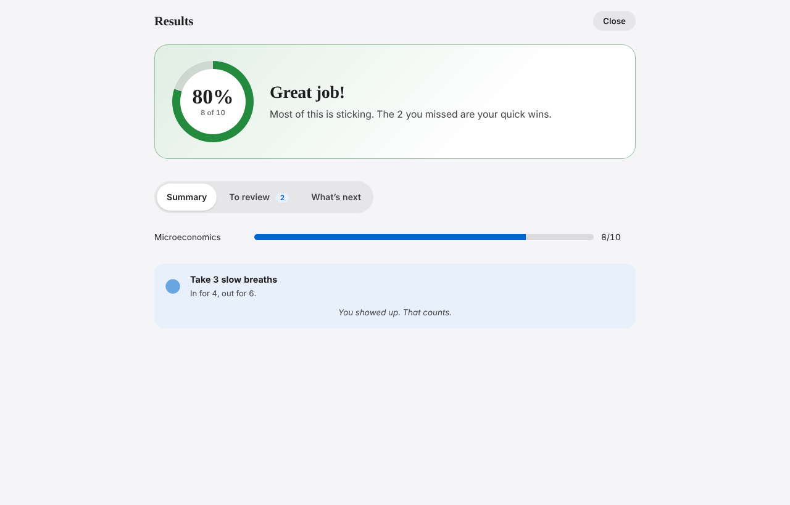
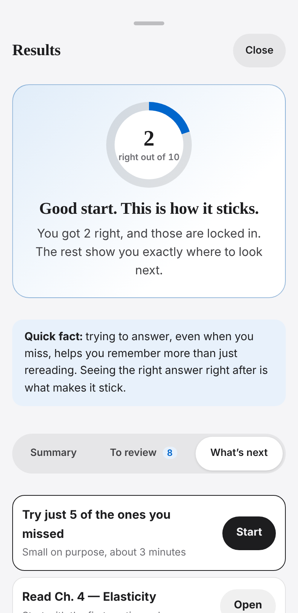
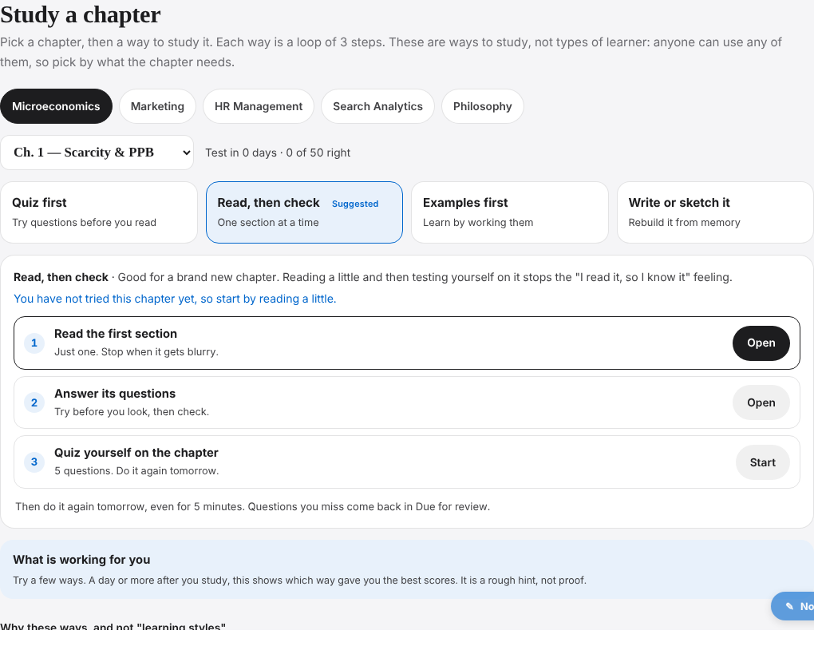
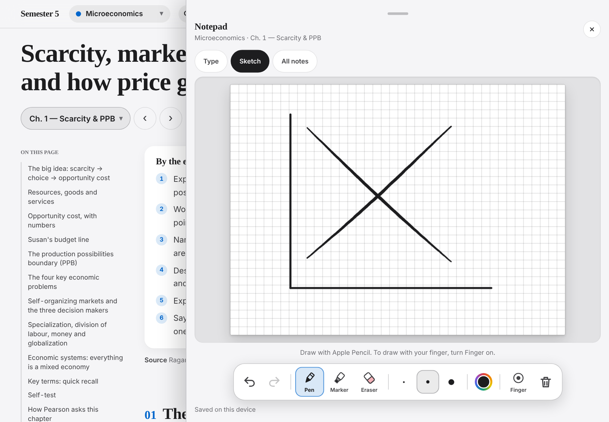
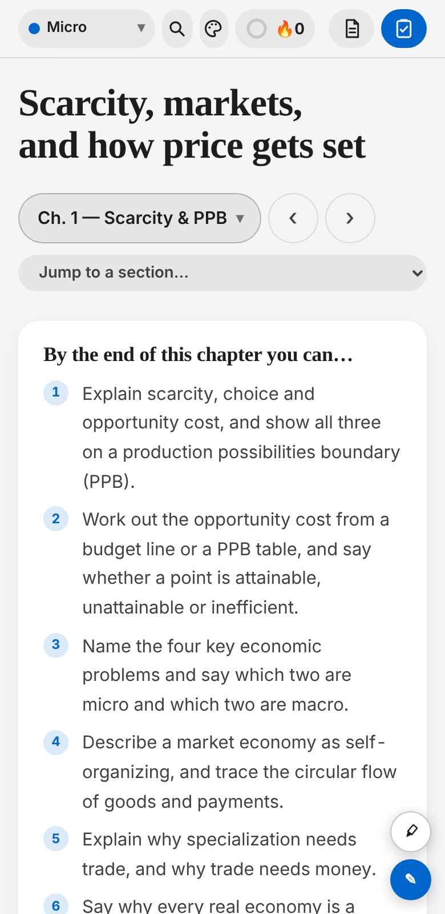

# Study Maps

A single-page study app I built with Claude for my Semester 5 courses at George Brown (Honours BBA, Business Analytics). It started as chapter summaries and grew into a small study system: self-tests, spaced review, exam mode, cheat sheets, a weak-spot report and a plan tab with deadlines. It works on phone, iPad and desktop.

| Desktop | Phone |
|---|---|
|  |  |

## Why I built it

- **To save time.** Every course has its own slides and its own textbook. I wanted all of them in one place instead of jumping between files before every test.
- **To make ideas stick.** After each part of a chapter I wanted real-life and work examples, so the material is useful beyond the exam.
- **To keep my plans in one place.** The plan tab tracks deadlines, test dates, readiness and weak spots, so I know what to study today.
- **To share it.** I am turning it into something classmates can use to study faster, with the same app for any course.

## What it does

- **5 courses, 26 chapter panels, 601 self-test questions.** Each chapter has learning goals, definitions, examples, exam traps, worked examples with hidden steps, flashcards and SVG diagrams.
- **Exam mode** with course, chapter, question type, count and timer choices, then a results screen with a score ring, a "To review" list and three kind next steps.
- **Spaced review.** Answers return on a schedule (0, 1, 3, 7, 14 and 30 days). Tapping "Sure" or "Guessing" before each answer flags the dangerous case: sure but wrong.
- **Plan tab.** What to do today, deadlines and exams, readiness per test, due for review and weak spots.
- **Cheat sheets and a one-pager** built from the chapter content.
- **Notes with sketch** (works with Apple Pencil on iPad), light and dark themes, motion that stops if your device asks for reduced motion.

| Plan | Exam results | Phone results |
|---|---|---|
|  |  |  |

| Study a chapter | iPad sketch | Phone |
|---|---|---|
|  |  |  |

## How it is built

- **Plain HTML, CSS and JavaScript.** No framework. Progress is saved in the browser (localStorage).
- **A Python build script** (`build/build.py`) stitches the page shell and the chapter fragments into one self-contained HTML file.
- **SVG diagrams** are generated and dropped into the panels at build time.
- **Playwright checks** in `tools/` test the finished page at phone and iPad sizes (no sideways scrolling, nothing cut off, tap targets at least 44px).

## Learn from it

Read in this order:
1. [docs/00-index.md](docs/00-index.md) lists every doc.
2. [docs/01-what-we-built.md](docs/01-what-we-built.md) is the story from the first version to now.
3. [docs/02-design-system.md](docs/02-design-system.md) covers fonts, colours, components and dark mode.
4. [docs/03-features-and-how-they-work.md](docs/03-features-and-how-they-work.md) explains the logic behind each feature (readiness, weak spots, spaced review).
5. [docs/ai-handoff/05-build-your-own.md](docs/ai-handoff/05-build-your-own.md) shows how to build the same thing for your own courses.

## Limits and next steps

- Progress is saved in each browser, so it does not sync between phone and laptop yet. Export/import and synced progress are next.
- **The chapter content is not in this repo.** It comes from my lecture slides and a course textbook, so this copy shows the app and how it works, but it does not build on its own. Add your own chapters with `docs/compact-format.md` and `docs/panel-authoring-spec.md`.

## What is in this repo

```
build/shell/   the app: app.js, CSS, plan tab and overlays
build/         build script and authoring helpers
addons/        search and other add-ons
tools/         page checks, screenshot and demo GIF scripts
docs/          design notes, feature notes, authoring guides and screenshots
```

Code is MIT licensed, see `LICENSE`.
